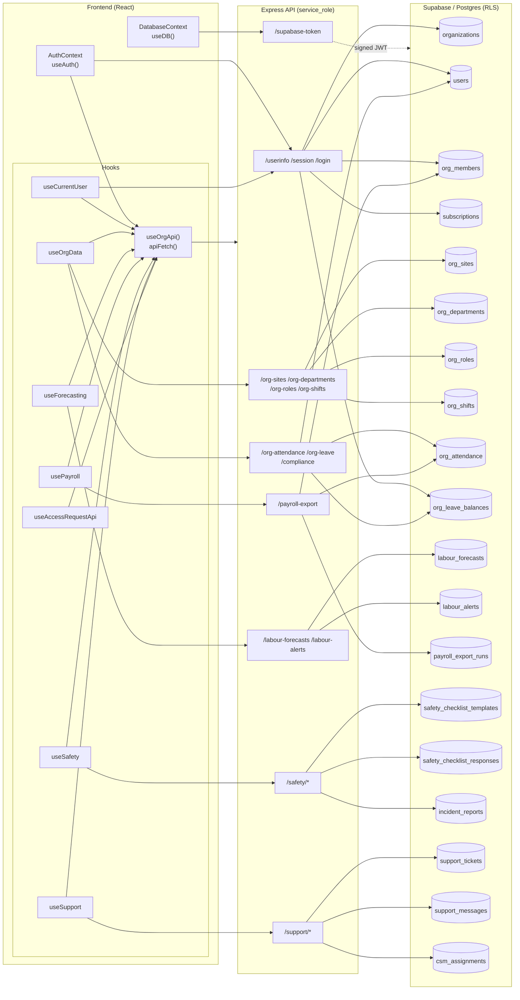
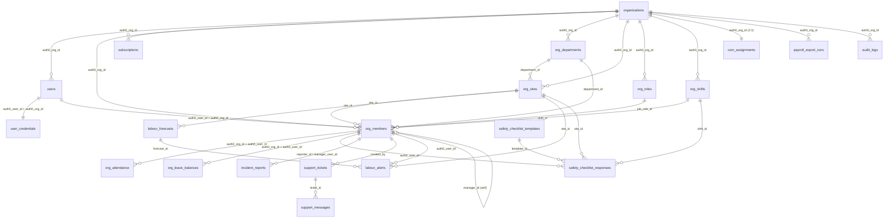
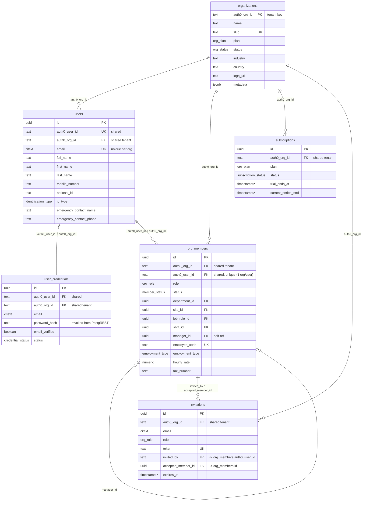
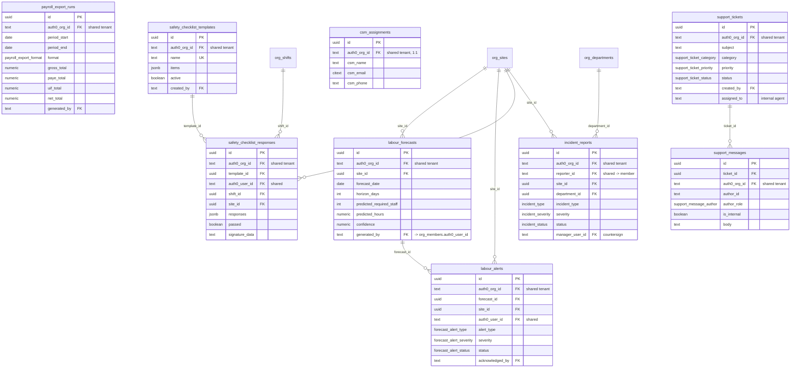
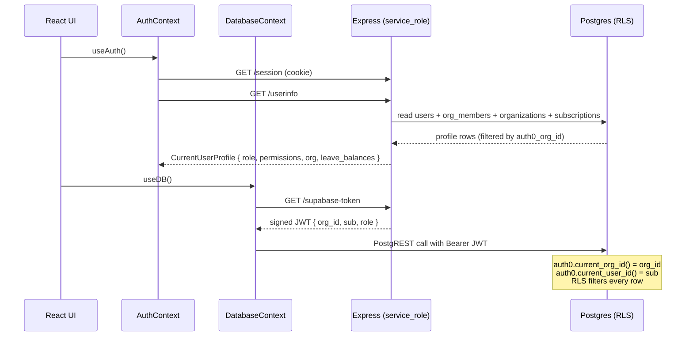
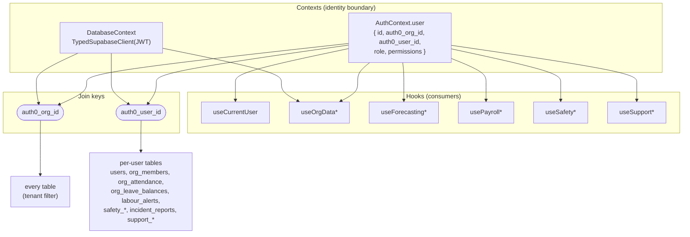
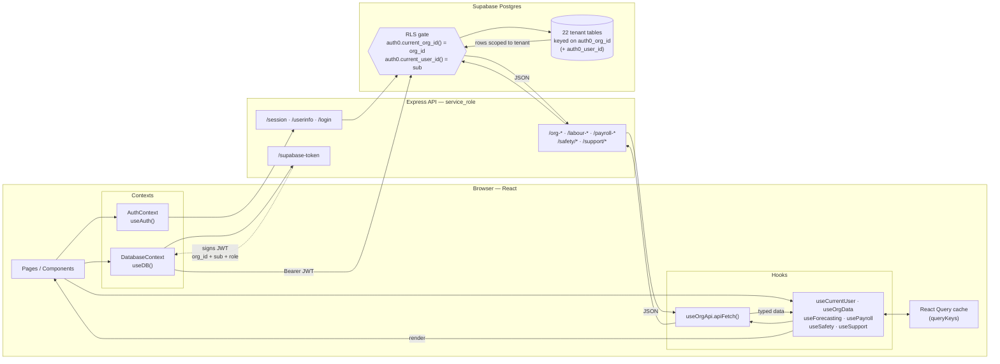

# EasyOps — Data Flow & Relationships

Visual map of how the frontend **hooks** and **contexts** connect through the Express API
to the Supabase **schema** (`20260731_remote_schema.sql`).

Two columns join _everything_ together:

| Shared column   | Meaning                        | Where it comes from                               |
| --------------- | ------------------------------ | ------------------------------------------------- |
| `auth0_org_id`  | Tenant key (text, never empty) | Auth0 JWT `org_id` → RLS `auth0.current_org_id()` |
| `auth0_user_id` | User identity (Auth0 `sub`)    | Auth0 JWT `sub` → RLS `auth0.current_user_id()`   |

Every table carries `auth0_org_id`; every per-user table also carries `auth0_user_id`.
RLS policies filter each request on these two columns.

---

## 1. High-level data flow

---

## 2. Hook → endpoint → table → columns

| Hook (file)                                              | Express endpoint                | Table(s)                                                                       | Key columns used / shared                                                                                           |
| -------------------------------------------------------- | ------------------------------- | ------------------------------------------------------------------------------ | ------------------------------------------------------------------------------------------------------------------- |
| `useCurrentUser` / `AuthContext`                         | `/userinfo`, `/session`         | `users`, `org_members`, `organizations`, `subscriptions`, `org_leave_balances` | `auth0_user_id`, `auth0_org_id`, `role`, `permissions`, `plan`, `leave_type`, `balance_days`                        |
| `useSites` (`useOrgData`)                                | `/org-sites`                    | `org_sites`                                                                    | `id`, `auth0_org_id`, `site_name`, `department_id`, `latitude`, `longitude`, `geo_radius_m`                         |
| `useDepartments` (`useOrgData`)                          | `/org-departments`              | `org_departments`                                                              | `id`, `auth0_org_id`, `department_name`                                                                             |
| `useRoles` (`useOrgData`)                                | `/org-roles`                    | `org_roles`                                                                    | `id`, `auth0_org_id`, `name`, `base_role`                                                                           |
| `useShifts` (`useOrgData`)                               | `/org-shifts`                   | `org_shifts`                                                                   | `id`, `auth0_org_id`, `shift_name`, `start_time`, `end_time`, `grace_period_minutes`, `weekly_hours`                |
| `useAttendanceRecords` (`useOrgData`)                    | `/org-attendance`               | `org_attendance` (+ `users`, `org_departments`, `org_sites` for names)         | `auth0_org_id`, `auth0_user_id`, `date`, `hours_worked`, `overtime`, `department_id`, `site_id`                     |
| `useLeaveBalances` (`useOrgData`)                        | `/org-leave?user_id=`           | `org_leave_balances`                                                           | `auth0_org_id`, `auth0_user_id`, `leave_type`, `balance_days`                                                       |
| `useComplianceCheck` (`useOrgData`)                      | `/compliance`                   | `org_attendance` (+ `org_shifts`)                                              | derived from `hours_worked`, `overtime`                                                                             |
| `useForecasts` (`useForecasting`)                        | `/labour-forecasts`             | `labour_forecasts`                                                             | `auth0_org_id`, `site_id`, `forecast_date`, `predicted_required_staff`, `predicted_hours`, `generated_by`           |
| `useAlerts` / `useUpdateAlert` (`useForecasting`)        | `/labour-alerts`                | `labour_alerts`                                                                | `auth0_org_id`, `forecast_id`, `site_id`, `auth0_user_id`, `alert_type`, `severity`, `status`                       |
| `usePayrollRuns` / `useGeneratePayroll` (`usePayroll`)   | `/payroll-export`               | `payroll_export_runs` (+ `org_attendance`, `org_members`)                      | `auth0_org_id`, `period_start`, `period_end`, `gross_total`, `paye_total`, `uif_total`, `net_total`, `generated_by` |
| `useSafetyTemplates` … (`useSafety`)                     | `/safety/templates`             | `safety_checklist_templates`                                                   | `id`, `auth0_org_id`, `name`, `items`, `active`, `created_by`                                                       |
| `useSafetyResponses` / `useSubmitResponse` (`useSafety`) | `/safety/responses`             | `safety_checklist_responses` (+ `users`)                                       | `auth0_org_id`, `auth0_user_id`, `template_id`, `shift_id`, `site_id`, `signature_data`, `passed`                   |
| `useIncidents` … (`useSafety`)                           | `/safety/incidents`             | `incident_reports` (+ `org_members`)                                           | `auth0_org_id`, `reporter_id`, `manager_user_id`, `site_id`, `department_id`, `incident_type`, `severity`, `status` |
| `useSupportTickets` … (`useSupport`)                     | `/support/tickets`              | `support_tickets`                                                              | `auth0_org_id`, `created_by`, `assigned_to`, `subject`, `category`, `priority`, `status`                            |
| `usePostReply` / `useSupportTicket` (`useSupport`)       | `/support/tickets/:id/messages` | `support_messages` (+ `support_tickets`)                                       | `ticket_id`, `auth0_org_id`, `author_id`, `author_role`, `is_internal`                                              |
| `useCsmContact` / `useUpsertCsm` (`useSupport`)          | `/support/csm`                  | `csm_assignments`                                                              | `auth0_org_id`, `csm_name`, `csm_email`, `csm_phone`                                                                |
| `useAccessRequestApi`                                    | `/access-requests`              | _(dropped in v2 — 404 at runtime)_                                             | —                                                                                                                   |
| `DatabaseContext` (`useDB`)                              | `/supabase-token`               | _(all tables via RLS)_                                                         | Injects signed JWT with `org_id` + `sub`                                                                            |

---

## 3. Schema relationships (entity view, join columns)

---

## 3b. Column-level schema (PK / FK / shared keys)

Full attribute view. `PK` = primary key, `FK` = foreign key, `UK` = unique key.
The two shared tenant columns (`auth0_org_id`, `auth0_user_id`) are flagged on every table
that carries them, since they are the join keys the RLS policies filter on.

### Identity & tenancy core

### Org structure & operations

```mermaid
erDiagram
    org_departments {
        uuid id PK
        text auth0_org_id FK "shared tenant"
        text department_name UK
    }
    org_sites {
        uuid id PK
        text auth0_org_id FK "shared tenant"
        uuid department_id FK
        text site_name UK
        text address
        double latitude
        double longitude
        numeric geo_radius_m
    }
    org_roles {
        uuid id PK
        text auth0_org_id FK "shared tenant"
        text name UK
        org_role base_role
    }
    org_shifts {
        uuid id PK
        text auth0_org_id FK "shared tenant"
        text shift_name UK
        time start_time
        time end_time
        int grace_period_minutes
        numeric weekly_hours
    }
    org_attendance {
        uuid id PK
        text auth0_org_id FK "shared tenant"
        text auth0_user_id FK "shared"
        date date UK "(org,user,date)"
        attendance_method method
        numeric hours_worked
        numeric overtime
        uuid department_id FK
        uuid site_id FK
    }
    org_leave_balances {
        uuid id PK
        text auth0_org_id FK "shared tenant"
        text auth0_user_id FK "shared"
        leave_type leave_type UK "(org,user,type)"
        numeric balance_days
    }
    audit_logs {
        uuid id PK
        text auth0_org_id FK "shared tenant"
        text auth0_user_id FK "shared actor"
        text action
        text resource_type
        text resource_id
        jsonb diff
    }

    org_departments ||--o{ org_sites : department_id
    org_departments ||--o{ org_members : department_id
    org_sites ||--o{ org_members : site_id
    org_roles ||--o{ org_members : job_role_id
    org_shifts ||--o{ org_members : shift_id
    org_members ||--o{ org_attendance : "auth0_org_id + auth0_user_id"
    org_members ||--o{ org_leave_balances : "auth0_org_id + auth0_user_id"
    org_departments ||--o{ org_attendance : department_id
    org_sites ||--o{ org_attendance : site_id
```

### Forecasting, payroll, safety & support

---

## 4. Context boundary (how identity reaches the DB)

---

## 5. Hooks → Contexts → Schema (the join map)

Every hook depends on exactly two contexts, and each context resolves to a
concrete set of schema columns. `AuthContext` supplies the **identity**
(`auth0_org_id`, `auth0_user_id`, `role`, `permissions`); `DatabaseContext`
supplies the **typed, RLS-scoped client** used for direct reads.

| Consumer (hook)              | `AuthContext` field used     | `DatabaseContext` used | Schema columns reached (via API/RLS)                                                             |
| ---------------------------- | ---------------------------- | ---------------------- | ------------------------------------------------------------------------------------------------ |
| `useCurrentUser`             | `user.id`, `isAuthenticated` | –                      | `users.*`, `org_members.role`, `organizations.*`, `subscriptions.plan`, `org_leave_balances`     |
| `useSites`                   | `user` (gate)                | `useDB()` (gate)       | `org_sites.id/site_name/department_id/lat/lng/geo_radius_m`                                      |
| `useDepartments`             | `user` (gate)                | –                      | `org_departments.id/department_name`                                                             |
| `useRoles`                   | `user` (gate)                | –                      | `org_roles.id/name/base_role`                                                                    |
| `useShifts`                  | `user` (gate)                | –                      | `org_shifts.id/shift_name/start_time/end_time`                                                   |
| `useAttendanceRecords`       | `user` (gate)                | –                      | `org_attendance.*` + `users` + `org_departments`/`org_sites` names                               |
| `useLeaveBalances`           | –                            | –                      | `org_leave_balances.leave_type/balance_days`                                                     |
| `useComplianceCheck`         | `user` (gate)                | –                      | `org_attendance` (+ `org_shifts`) derived                                                        |
| `useForecasts` / `useAlerts` | `user` (gate)                | –                      | `labour_forecasts.*`, `labour_alerts.*`                                                          |
| `usePayrollRuns`             | `user` (gate)                | –                      | `payroll_export_runs.*` (+ `org_attendance`, `org_members`)                                      |
| `useSafety*`                 | `user` (gate)                | –                      | `safety_checklist_templates/_responses`, `incident_reports`                                      |
| `useSupport*`                | `user` (gate)                | –                      | `support_tickets/_messages`, `csm_assignments`                                                   |
| `AuthContext` (self)         | –                            | –                      | `/userinfo` → `users` + `org_members` + `organizations` + `subscriptions` + `org_leave_balances` |
| `DatabaseContext` (self)     | –                            | issues client          | `/supabase-token` → signed JWT `{ org_id, sub, role }` for RLS                                   |

---

## 6. Final end-to-end data flow

**Read path:** Component → hook → `useOrgApi` → Express (service_role) → RLS-scoped query → table rows → JSON back up the chain, cached by React Query.
**Identity path:** `AuthContext` establishes the session (`auth0_org_id` + `auth0_user_id`); `DatabaseContext` mints the signed JWT so any direct `useDB()` read is filtered by the same two keys.

---

### Notes

- **`useOrgApi`** is the shared transport — every data hook calls its `apiFetch`, which sends the session cookie (`credentials: 'include'`). It touches no table directly.
- **`org_attendance`** has RLS enabled but _no direct-read policy_, so the client cannot read it via `useDB()`; it is served only through the service-role Express `/org-attendance` endpoint (see [useOrgData.ts](../src/hooks/useOrgData.ts#L74-L90)).
- **`user_credentials.password_hash`** is never exposed through PostgREST (column-level `revoke`); only the Auth0 custom-DB scripts and Express (service_role) read it.
- **`useAccessRequestApi`** targets a feature removed in v2; its endpoints 404.
