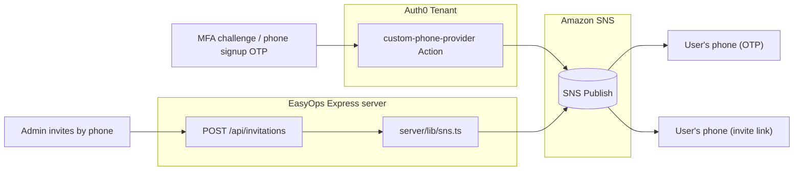

# Amazon SNS + Phone Identifier Integration — Reference Plan

Status: code complete, migration applied to the live DB and types regenerated
(confirmed 2026-08-21). Only Dashboard/AWS console configuration remains.
Owner: EasyOps platform team.

This document is the single reference for how SMS/phone works in EasyOps: OTP
delivery (MFA + phone-verification-at-signup) and phone-based invitations. Two
independent integrations exist — do not conflate them, they use different
credentials and run in different environments.

---

## 1. Architecture overview

|                       | Trigger                                                                         | Runs in                     | Credentials                                               |
| --------------------- | ------------------------------------------------------------------------------- | --------------------------- | --------------------------------------------------------- |
| **A. OTP delivery**   | Auth0 Phone Provider (MFA challenges + phone-number verification during signup) | Auth0's own Actions sandbox | Auth0 Action Secrets (Dashboard-only, never in this repo) |
| **B. Invitation SMS** | `POST /api/invitations` when an admin invites someone by phone                  | Express server (this repo)  | `.env` / deployment env vars                              |

Both call Amazon SNS `PublishCommand` directly with a bare `PhoneNumber` (no
SNS Topics or Subscriptions are used anywhere in this integration).

## 2. Part A — OTP via Auth0 Custom Phone Provider

### Code (already committed)

- `auth0/actions/custom-phone-provider.js`: Defines
  `exports.onExecuteCustomPhoneProvider = async (event, api) => {...}`. It
  publishes `event.notification.as_text` to `event.notification.recipient` via
  `@aws-sdk/client-sns`, only for text delivery, with `SMSType` set to
  `Transactional`. Failures retry through `api.notification.retry()`.

### Dashboard execution steps (manual, one-time)

1. Go to **Branding** → **Phone Provider**, select **Custom**, and select the
   **Text** delivery method.
2. Paste the script into **Provider Configuration**.
3. Add the `@aws-sdk/client-sns` npm dependency (latest 3.x) in the same
   editor.
4. Add Action Secrets: `AWS_ACCESS_KEY_ID`, `AWS_SECRET_ACCESS_KEY`,
   `AWS_REGION`, and optional `AWS_SNS_SENDER_ID`.
5. Save to auto-deploy, then use **Send Test Message** before relying on it in
   production.
6. Go to **Authentication** → **Database** → _your connection_ →
   **Attributes** → **Activate**. Enable **Phone Number** as an identifier and
   **Verify phone on signup**. This invokes the Action during signup.
7. Configure **Identifier First** under **Authentication** → **Universal
   Login**. It is required for phone verification at signup.
8. Go to **Security** → **Multi-factor Auth** → **Phone Message** and enable
   **Use Tenant-level Messaging Provider** if that option is available in the
   tenant.

Reference: `docs/auth0-metadata-checklist.txt`, sections 8 (provider setup)
and 9 (flexible identifiers).

## 3. Part B — Invitation-link SMS (app-level)

- `server/lib/sns.ts`: Lazy `SNSClient` singleton and
  `sendSms(phoneNumber, message)`.
- `server/lib/phone.ts`: Shared `E164_RE` validator.
- `server/routes/invitations.ts`:
  - `POST /api/invitations` accepts email or `phone_number`/`mobile_number`.
    The two frontend callers use different phone field names.
  - Email invitations still use Auth0's native, email-only Organization
    Invitation API.
  - Phone invitations bypass that API because Auth0 has no SMS organization
    invitation. They insert into `public.invitations` using `phone_number`,
    build `{appBaseUrl}/accept-invite/{token}`, and send the link with
    `sendSms`.
  - `GET /api/invitations/token/:token` is public because the invitee is not
    yet authenticated.
- `src/pages/InviteAccept.tsx`: Handles `/accept-invite/:token`, resolves the token,
  and calls `login({ auth0OrgId })` → `/api/login?organization=...` for
  Universal Login signup. The route is added in `src/App.tsx` alongside a backward-compatible
  redirect from `/invite/:token` to `/accept-invite/:token`.
- `src/pages/workspace/Members.tsx` and
  `src/components/employees/InviteEmployeeDialog.tsx`: Both invitation entry
  points include an Email/Phone toggle.

### Execution steps (yours to do)

1. Add `AWS_REGION`, `AWS_ACCESS_KEY_ID`, `AWS_SECRET_ACCESS_KEY`, and optional
   `AWS_SNS_SENDER_ID` to `.env.local` and the deployment environment.
2. Keep these separate from Part A's Action Secrets; the Express server cannot
   read Auth0 Dashboard secrets.
3. Scope the IAM principal to `sns:Publish` only. It may reuse Part A's key or
   use a dedicated key.

## 4. Shared AWS setup (do once)

1. Create an IAM user or role with an inline policy scoped to `sns:Publish`.
2. In **Console** → **SNS** → **Text messaging (SMS)** → **Text messaging
   preferences**, set the default message type to **Transactional** and set a
   monthly spend limit.
3. Check whether the account is in the SNS SMS sandbox. New AWS accounts can
   send only to verified recipient numbers until production access is granted.
   In **Console** → **SNS** → **Text messaging (SMS)**, check the **Sandbox**
   status and submit a support case to move to production if needed.

No SNS Topics or Subscriptions are required; both paths publish directly to a
phone number.

## 5. Database schema (already migrated in code, apply to live DB)

Migration: `supabase/migrations/20260819120000_phone_identifier_support.sql`

- `invitations.email` is nullable, with a `phone_number` column and a check
  requiring email or phone number.
- `user_credentials.email` is nullable, with `phone_verified` and a check
  requiring email or `mobile_number`.
- `users.email` is nullable, with a per-organization unique index on
  `mobile_number`.
- No uniqueness constraint was added for `user_credentials.mobile_number`.
  This mirrors the pre-existing, unenforced email uniqueness behavior in
  `login.js` and `get-user.js` rather than introducing asymmetric rigor.

Apply the migration to the live database through the pooler/Postgres path used
elsewhere in this project. Then regenerate `server/types/supabase.ts` and
`src/integrations/supabase/types.ts`, reconciling them with the existing
hand-edits; they should match.

**Confirmed 2026-08-21:** all three ALTERs, both CHECK constraints, and all
three indexes were already live (verified via direct introspection query).
`node server/scripts/gen-types.mjs` was re-run and both type files now
natively include `phone_number`/`phone_verified` — no drift from the earlier
hand-edits. `npm run build`, `npm run build:server`, and `eslint .` are all
green.

## 6. Auth0 custom DB scripts touched

| Script                                      | Change                                                                                                                                                 |
| ------------------------------------------- | ------------------------------------------------------------------------------------------------------------------------------------------------------ |
| `auth0/database-scripts/create.js`          | Resolves invitations and provisions identities by either email or `phone_number`; returns `phone_number` and `phone_verified` in the callback profile. |
| `auth0/database-scripts/login.js`           | Matches `lower(email) = lower($1)` or `mobile_number = $1`.                                                                                            |
| `auth0/database-scripts/get-user.js`        | Uses the same dual-identifier match without a password check.                                                                                          |
| `auth0/database-scripts/change-password.js` | Uses the same dual-identifier match.                                                                                                                   |
| `auth0/database-scripts/verify.js`          | Unchanged. It handles email magic-link verification only; Auth0's OTP flow handles phone verification.                                                 |
| `auth0/database-scripts/delete.js`          | Unchanged; keys off the internal ID.                                                                                                                   |

The `post-login.js` and `post-user-registration.js` Auth0 Actions now forward
`event.user.phone_number` with email to `POST /api/auth/sync`.
`pre-user-registration.js` is unchanged because it is already
identifier-agnostic.

## 7. Verification checklist

1. In the Auth0 Dashboard, use **Phone Provider** → **Send Test Message** to
   validate Part A.
2. In production, set `OIDC_BASE_URL` to the canonical HTTPS app origin (not
   localhost). `BASE_URL` and `APP_URL`, when present, must name that same
   origin because they are fallbacks for public invitation links and OIDC
   callbacks (defaulting to `http://localhost:5173` in local development).
   Set `VITE_APP_URL` to the browser app origin for cross-origin API deployments;
   leave `VITE_API_URL` unset for Vercel's same-origin `/api` deployment, or set
   it to `http://localhost:3000/api` for a split local setup.
3. Invite a real user by phone from the Members or Team Members page and
   confirm that the SMS arrives with a working `/accept-invite/:token` link. Open it
   in a fresh browser session and verify its assets load from `/assets/*`, not
   `/accept-invite/assets/*`.
4. Complete a phone-only signup after enabling Flexible Identifiers and
   Identifier First. Decode the resulting token and confirm `phone_number` and
   `phone_verified` behave as expected.
5. If a message does not arrive, check AWS SNS delivery status and CloudWatch
   logs. Auth0 does not surface tenant-level provider delivery failures to the
   end user.
6. Ensure `npm run build`, `npm run build:server`, and ESLint remain green
   after further changes in this area.

## 8. Known limitations / explicit follow-ups (not in scope)

- The MFA enrollment UI in
  `src/pages/settings/SettingsSecurity.tsx` (the **Enable 2FA** button) remains
  a placeholder. Wiring it to `@auth0/auth0-react`'s MFA API
  (`enroll`/`challenge`/`verify`) is a separate task.
- Auth0's Organization Invitation API remains email-only. Phone invitations
  will continue to use this repository's custom SMS-link flow rather than a
  native Auth0 invitation ticket.
- `user_credentials.mobile_number` and `user_credentials.email` have no
  database-enforced global uniqueness; this is an intentionally unchanged,
  pre-existing design.

## 9. Troubleshooting quick reference

| Symptom                                                    | Likely cause                                                                                                                                         |
| ---------------------------------------------------------- | ---------------------------------------------------------------------------------------------------------------------------------------------------- |
| **Send Test Message** fails in Dashboard                   | Incorrect or missing `AWS_ACCESS_KEY_ID`, `AWS_SECRET_ACCESS_KEY`, or `AWS_REGION` Action Secrets, or an IAM policy missing `sns:Publish`.           |
| Invitation SMS never arrives and the app shows no error    | SNS SMS sandbox mode; the recipient number is unverified. Check **Console** → **SNS** → **Text messaging (SMS)**.                                    |
| Phone signup fails at Universal Login                      | Flexible Identifiers or Identifier First is not configured on the connection.                                                                        |
| `/accept-invite/:token` shows “invalid or expired”         | The invitation was accepted, revoked, or has passed `expires_at`; re-invite the user.                                                                |
| `POST /api/invitations` returns 500 for a phone invitation | Server-side `AWS_REGION`, `AWS_ACCESS_KEY_ID`, or `AWS_SECRET_ACCESS_KEY` environment variables are missing. These are separate from Action Secrets. |
